# Poly Haven: Brick & Block textures

**40 assets from [Poly Haven](https://polyhaven.com), dedicated to the public domain under [CC0](https://polyhaven.com/license).** Use them in any game, free or paid, and change them however you like; no credit is needed.

PBR textures as 1K and 2K JPG maps (colour, normal (GL and DX), roughness, AO, displacement and more). 896.9 MB in all.

This is a copy kept by [zuujis-cc0](https://github.com/zuujis-cc0) so game makers can take single files from GitHub. It is not made by or affiliated with Poly Haven: the originals, often in more formats and higher resolutions, are on [polyhaven.com](https://polyhaven.com). If they help you, consider [supporting Poly Haven](https://www.patreon.com/polyhaven/overview).

Every file is listed in [MANIFEST.tsv](MANIFEST.tsv) with its size and SHA-256. More free assets: [the Zuujis collection](https://github.com/zuujis-cc0/free-game-assets#readme).

| | | | |
| :-: | :-: | :-: | :-: |
| <a href="blue_floor_tiles_01">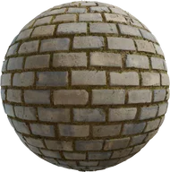</a> <b><a href="blue_floor_tiles_01">Blue Floor Tiles 01</a></b> by Rob Tuytel · <a href="https://polyhaven.com/a/blue_floor_tiles_01">source</a> | <a href="brick_4">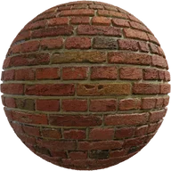</a> <b><a href="brick_4">Brick 4</a></b> by Rob Tuytel · <a href="https://polyhaven.com/a/brick_4">source</a> | <a href="brick_crosswalk">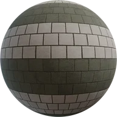</a> <b><a href="brick_crosswalk">Brick Crosswalk</a></b> by Charlotte Baglioni · <a href="https://polyhaven.com/a/brick_crosswalk">source</a> | <a href="brick_floor">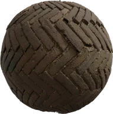</a> <b><a href="brick_floor">Brick Floor</a></b> by Rob Tuytel · <a href="https://polyhaven.com/a/brick_floor">source</a> |
| <a href="brick_floor_02">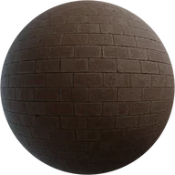</a> <b><a href="brick_floor_02">Brick Floor 02</a></b> by Charlotte Baglioni · <a href="https://polyhaven.com/a/brick_floor_02">source</a> | <a href="brick_floor_04">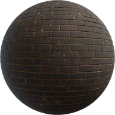</a> <b><a href="brick_floor_04">Brick Floor 04</a></b> by Dimitrios Savva · <a href="https://polyhaven.com/a/brick_floor_04">source</a> | <a href="brick_moss_001">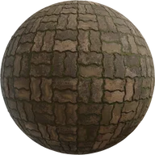</a> <b><a href="brick_moss_001">Brick Moss 001</a></b> by Dimitrios Savva, Rico Cilliers · <a href="https://polyhaven.com/a/brick_moss_001">source</a> | <a href="brick_pavement">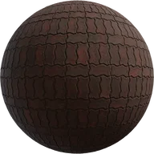</a> <b><a href="brick_pavement">Brick Pavement</a></b> by Charlotte Baglioni · <a href="https://polyhaven.com/a/brick_pavement">source</a> |
| <a href="brick_pavement_02">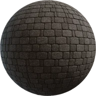</a> <b><a href="brick_pavement_02">Brick Pavement 02</a></b> by Charlotte Baglioni · <a href="https://polyhaven.com/a/brick_pavement_02">source</a> | <a href="brick_pavement_03">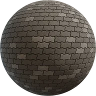</a> <b><a href="brick_pavement_03">Brick Pavement 03</a></b> by Charlotte Baglioni · <a href="https://polyhaven.com/a/brick_pavement_03">source</a> | <a href="brick_pavement_04">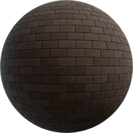</a> <b><a href="brick_pavement_04">Brick Pavement 04</a></b> by Charlotte Baglioni · <a href="https://polyhaven.com/a/brick_pavement_04">source</a> | <a href="brick_villa_floor">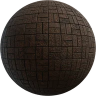</a> <b><a href="brick_villa_floor">Brick Villa Floor</a></b> by Dimitrios Savva · <a href="https://polyhaven.com/a/brick_villa_floor">source</a> |
| <a href="brick_wall_001">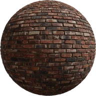</a> <b><a href="brick_wall_001">Brick Wall 001</a></b> by Dimitrios Savva, Rob Tuytel · <a href="https://polyhaven.com/a/brick_wall_001">source</a> | <a href="brick_wall_003">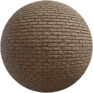</a> <b><a href="brick_wall_003">Brick Wall 003</a></b> by Dimitrios Savva, Rob Tuytel · <a href="https://polyhaven.com/a/brick_wall_003">source</a> | <a href="brick_wall_005">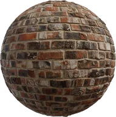</a> <b><a href="brick_wall_005">Brick Wall 005</a></b> by Dario Barresi, Dimitrios Savva · <a href="https://polyhaven.com/a/brick_wall_005">source</a> | <a href="brick_wall_006">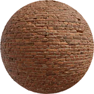</a> <b><a href="brick_wall_006">Brick Wall 006</a></b> by Jan Burghardt · <a href="https://polyhaven.com/a/brick_wall_006">source</a> |
| <a href="brick_wall_02">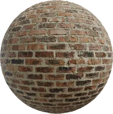</a> <b><a href="brick_wall_02">Brick Wall 02</a></b> by Dimitrios Savva · <a href="https://polyhaven.com/a/brick_wall_02">source</a> | <a href="brick_wall_04">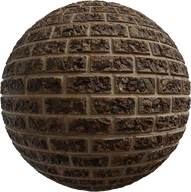</a> <b><a href="brick_wall_04">Brick Wall 04</a></b> by Dario Barresi, Dimitrios Savva, Rico Cilliers · <a href="https://polyhaven.com/a/brick_wall_04">source</a> | <a href="brick_wall_07">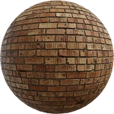</a> <b><a href="brick_wall_07">Brick Wall 07</a></b> by Dimitrios Savva · <a href="https://polyhaven.com/a/brick_wall_07">source</a> | <a href="brick_wall_08">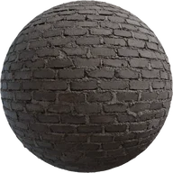</a> <b><a href="brick_wall_08">Brick Wall 08</a></b> by Amal Kumar · <a href="https://polyhaven.com/a/brick_wall_08">source</a> |
| <a href="brick_wall_09">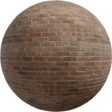</a> <b><a href="brick_wall_09">Brick Wall 09</a></b> by Matterfield, Rob Tuytel · <a href="https://polyhaven.com/a/brick_wall_09">source</a> | <a href="brick_wall_10">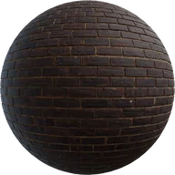</a> <b><a href="brick_wall_10">Brick Wall 10</a></b> by Dimitrios Savva · <a href="https://polyhaven.com/a/brick_wall_10">source</a> | <a href="brick_wall_11">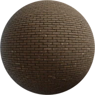</a> <b><a href="brick_wall_11">Brick Wall 11</a></b> by Rob Tuytel · <a href="https://polyhaven.com/a/brick_wall_11">source</a> | <a href="brick_wall_12">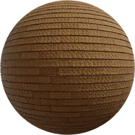</a> <b><a href="brick_wall_12">Brick Wall 12</a></b> by Dimitrios Savva · <a href="https://polyhaven.com/a/brick_wall_12">source</a> |
| <a href="brick_wall_13">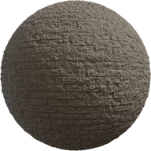</a> <b><a href="brick_wall_13">Brick Wall 13</a></b> by Rob Tuytel · <a href="https://polyhaven.com/a/brick_wall_13">source</a> | <a href="broken_brick_wall">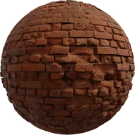</a> <b><a href="broken_brick_wall">Broken Brick Wall</a></b> by Amal Kumar · <a href="https://polyhaven.com/a/broken_brick_wall">source</a> | <a href="brown_brick_02">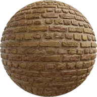</a> <b><a href="brown_brick_02">Brown Brick 02</a></b> by Rob Tuytel · <a href="https://polyhaven.com/a/brown_brick_02">source</a> | <a href="castle_brick_01">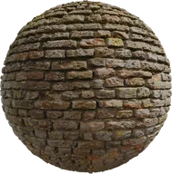</a> <b><a href="castle_brick_01">Castle Brick 01</a></b> by Rob Tuytel · <a href="https://polyhaven.com/a/castle_brick_01">source</a> |
| <a href="castle_brick_02_red">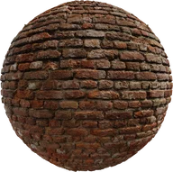</a> <b><a href="castle_brick_02_red">Castle Brick 02 Red</a></b> by Rob Tuytel · <a href="https://polyhaven.com/a/castle_brick_02_red">source</a> | <a href="castle_brick_02_white">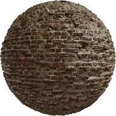</a> <b><a href="castle_brick_02_white">Castle Brick 02 White</a></b> by Rob Tuytel · <a href="https://polyhaven.com/a/castle_brick_02_white">source</a> | <a href="castle_brick_07">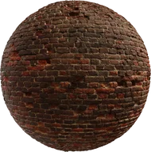</a> <b><a href="castle_brick_07">Castle Brick 07</a></b> by Rob Tuytel · <a href="https://polyhaven.com/a/castle_brick_07">source</a> | <a href="castle_brick_broken_06">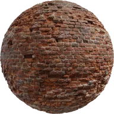</a> <b><a href="castle_brick_broken_06">Castle Brick Broken 06</a></b> by Rob Tuytel · <a href="https://polyhaven.com/a/castle_brick_broken_06">source</a> |
| <a href="castle_wall_slates">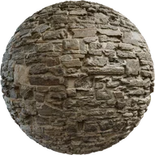</a> <b><a href="castle_wall_slates">Castle Wall Slates</a></b> by Rob Tuytel · <a href="https://polyhaven.com/a/castle_wall_slates">source</a> | <a href="checkered_pavement_tiles">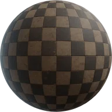</a> <b><a href="checkered_pavement_tiles">Checkered Pavement Tiles</a></b> by Amal Kumar · <a href="https://polyhaven.com/a/checkered_pavement_tiles">source</a> | <a href="church_bricks_02">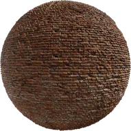</a> <b><a href="church_bricks_02">Church Bricks 02</a></b> by Rob Tuytel · <a href="https://polyhaven.com/a/church_bricks_02">source</a> | <a href="church_bricks_03">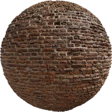</a> <b><a href="church_bricks_03">Church Bricks 03</a></b> by Rob Tuytel · <a href="https://polyhaven.com/a/church_bricks_03">source</a> |
|  <b><a href="clay_block_wall">Clay Block Wall</a></b> by Amal Kumar · <a href="https://polyhaven.com/a/clay_block_wall">source</a> | <a href="cobblestone_03">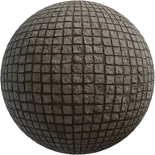</a> <b><a href="cobblestone_03">Cobblestone 03</a></b> by Charlotte Baglioni · <a href="https://polyhaven.com/a/cobblestone_03">source</a> | <a href="concrete_block_wall">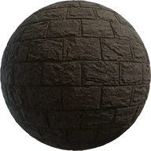</a> <b><a href="concrete_block_wall">Concrete Block Wall</a></b> by Charlotte Baglioni · <a href="https://polyhaven.com/a/concrete_block_wall">source</a> |  <b><a href="concrete_block_wall_02">Concrete Block Wall 02</a></b> by Charlotte Baglioni · <a href="https://polyhaven.com/a/concrete_block_wall_02">source</a> |

---

Kept up to date by this repository's own [update workflow](.github/workflows/update.yml), with code and plan from [cc0-mirror](https://github.com/zuujis-cc0/cc0-mirror). Something wrong? [Open an issue there](https://github.com/zuujis-cc0/cc0-mirror/issues/new) or use the [private report form](https://games.zuujis.com/report).
